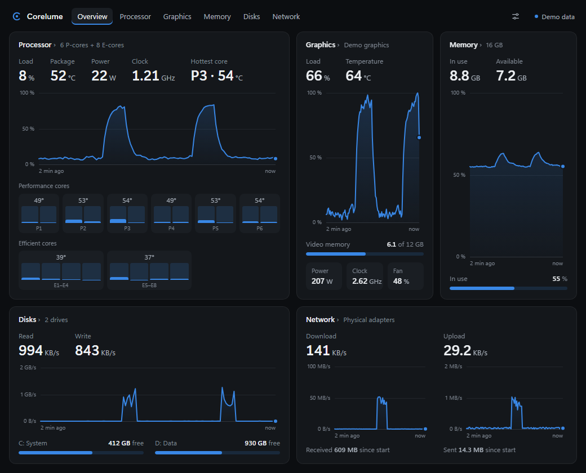

# Corelume

A light system monitor for Windows. Processor, graphics card, memory, disks and network
on one dashboard, plus small widgets pinned to your desktop.

## What it shows

- **Processor**: load per core, temperatures, power, and whether it is held back by its
  power limit or by heat.
- **Graphics card**: load, temperature, power, clocks, video memory.
- **Memory**: where all of it goes, including what Task Manager leaves out (compressed
  memory, Windows itself, drivers).
- **Disks**: read and write speed, free space.
- **Network**: download and upload, per adapter.
- **Desktop widgets** that stay behind your windows, in a light, dark or system theme.

## Requirements

- Windows 11, 64-bit. Windows 10 should work but has not been tested.
- CPU temperatures and power need an Intel processor. Everything else works on any PC.
- Graphics details need an NVIDIA graphics card.

## Install

1. Download `Corelume_1.0.0_x64-setup.exe` from the [latest release](../../releases/latest).
2. Run it and accept the administrator prompt.

   The installer is not signed, so Windows SmartScreen may warn you: choose
   **More info**, then **Run anyway**.

The installer also:

- installs the [PawnIO](https://github.com/namazso/PawnIO) driver if it is missing. Corelume uses it to read
  CPU temperatures and power, and only reads.
- lets Corelume start with administrator rights without asking you each time (it needs
  them to read the CPU sensors), and starts it with Windows. You can turn that off in
  Corelume's **Settings**.

Closing the window keeps Corelume running next to the clock. To quit, right-click its icon
there and choose **Quit Corelume**.

## Update

1. Quit Corelume: right-click its icon next to the clock, then **Quit Corelume**.
2. Download the new setup from the [latest release](../../releases/latest) and run it.

It replaces the old version and keeps your settings.

## Resource use

Measured with version 1.0.0, one reading per second. Memory counts Corelume and its
display processes (WebView2). Processor is the share of the whole processor.

| Corelume is…                                   | Memory | Processor |
| ---------------------------------------------- | -----: | --------: |
| open                                           | 255 MB |    0.05 % |
| minimised                                      | 248 MB |    0.04 % |
| closed, only its icon next to the clock        |  37 MB |  < 0.01 % |
| closed, with all 5 widgets on the desktop      | 329 MB |    0.08 % |

Corelume reads your PC's sensors locally and sends nothing over the network.

## License

Corelume is under the [MIT License](LICENSE).

The installer includes the PawnIO driver setup (GPL-2.0) and its IntelMSR module
(LGPL-2.1), unmodified, from their author: see [vendor/pawnio](vendor/pawnio/README.md).
Their source code is attached to each release.
